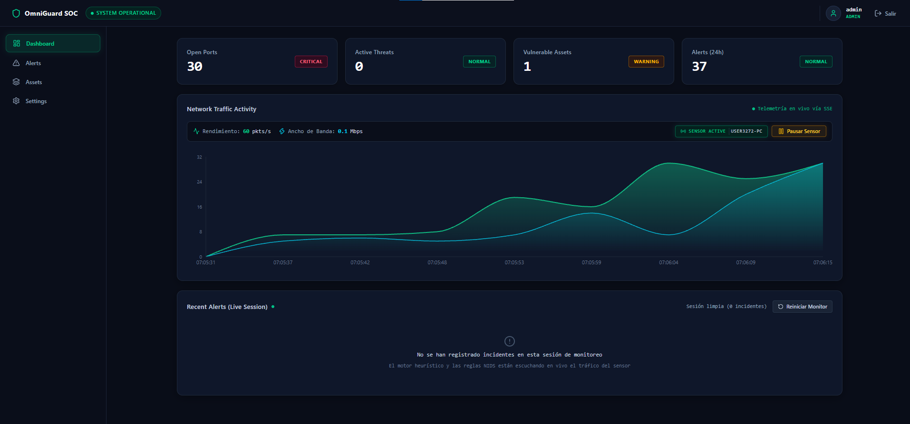

# OmniGuard SOC — Motor de Detección Heurística y Análisis de Tráfico (NIDS)

<div align="center">
  
  <h3>Plataforma Distribuida de Ciberseguridad Defensiva y Alerta Temprana</h3>
  <p>Microservicio de Análisis Heurístico, Gestión de Eventos y Detección de Intrusiones</p>
</div>

---

## 1. Resumen Ejecutivo y Propósito

El microservicio `omniguard-analyzer-python` constituye el componente de inteligencia analítica del ecosistema OmniGuard SOC. Su función esencial radica en la ingesta, normalización, correlación y evaluación heurística en tiempo real de los flujos de telemetría de red emitidos por los sensores de bajo nivel (`omniguard-sensor-cpp`).

El motor opera bajo un modelo de desacoplamiento asíncrono, consumiendo eventos crudos desde un bus de mensajería Redis Pub/Sub, ejecutando algoritmos de ventana deslizante para la identificación de patrones hostiles, persistiendo la topología de activos y alertas en PostgreSQL, despachando notificaciones fuera de banda a plataformas de mensajería (Discord y Telegram) y alimentando al backend transaccional (`omniguard-core-java`) mediante peticiones REST autenticadas.

---

## 2. Vista Previa del Sistema

<div align="center">
  
  <p><em>Consola de mando y autenticación protegida del ecosistema OmniGuard SOC.</em></p>
</div>

---

## 3. Arquitectura del Flujo de Datos

```
[ Sensor C++ (libpcap) ]
           |
           | JSON crudo (PUBLISH 'network_events')
           v
[ Redis Pub/Sub (Broker) ]
           |
           | Ingesta continua (SUBSCRIBE)
           v
[ omniguard-analyzer-python ]
   ├── detector.py        (Ventana deslizante / Heurísticas)
   ├── persistence.py     (Pool de conexiones / Persistencia SQL)
   ├── notifier.py        (Despacho Discord Webhook & Telegram Bot)
   └── scan_worker.py     (Worker de escaneo activo y banner grabbing)
           |
           +---------------------------------------+
           |                                       |
           v (SQL INSERT/UPDATE)                   v (HTTP POST /alerts)
[ PostgreSQL 16 Alpine ]                 [ omniguard-core-java ]
(Esquemas: assets, alerts)               (Spring Boot 3.2 - SSE Stream)
```

---

## 4. Heurísticas y Reglas de Detección Implementadas

El motor heurístico implementado en `detector.py` evalúa continuamente los paquetes normalizados utilizando algoritmos de ventana temporal fija y deslizante, mitigando falsos positivos mediante umbrales parametrizables:

### 4.1. Detección de Ataques de Fuerza Bruta
* **Servicios Monitoreados:** SSH (puerto 22), RDP (puerto 3389) y FTP (puerto 21).
* **Mecanismo:** Seguimiento de intentos repetidos de conexión por cada tupla `(IP_Origen, IP_Destino, Puerto)` en una ventana temporal de 60 segundos.
* **Umbral:** Disparo de alerta crítica al superar los 10 intentos dentro del intervalo temporal, registrando la tasa de concurrencia y la firma temporal.

### 4.2. Detección de Escaneo de Puertos
* **Escaneo Vertical:** Detección de una única dirección IP de origen sondeando más de 15 puertos diferentes en un mismo activo de destino en un lapso menor o igual a 30 segundos.
* **Escaneo Horizontal:** Detección de una dirección IP de origen consultando el mismo puerto específico a través de múltiples activos de la subred dentro de la ventana de análisis.

### 4.3. Detección de Banderas TCP Anómalas (Stealth Scans)
* **Escaneo NULL:** Paquetes TCP que no contienen ninguna bandera de control activada (`flags == 0`), técnica empleada para evadir inspecciones tradicionales sin estado.
* **Escaneo XMAS:** Paquetes con una combinación inconsistente de banderas activas (FIN, URG y PSH simultáneamente), diseñada para forzar respuestas RST en implementaciones RFC 793.
* **Escaneo FIN:** Transmisión de paquetes FIN sin un establecimiento de enlace previo de tres vías (3-Way Handshake).

---

## 5. Worker de Escaneo Activo (`scan_worker.py`)

A diferencia del flujo pasivo de eventos, el módulo `scan_worker.py` actúa bajo demanda para la auditoría activa de la superficie de ataque:

1. **Recepción de Órdenes:** Escucha comandos de auditoría publicados en el canal Redis `scan_commands_channel`.
2. **Validación Estricta de Rango (Allowlist):** Valida que el objetivo pertenezca estrictamente a bloques de red autorizados (`ALLOWED_SCAN_RANGES`), previniendo el uso indebido del motor contra infraestructura externa no permisionada.
3. **Banner Grabbing No Bloqueante:** Ejecuta sondeos de conexión TCP sobre puertos seleccionados para extraer cadenas de versión expuestas por los servicios (por ejemplo, servidores OpenSSH, servidores web Nginx o bases de datos).
4. **Construcción de Identificadores CPE:** Traduce las cadenas de software capturadas a formatos de Enumeración de Plataformas Comunes (CPE 2.3), habilitando el cruce automatizado con la base de datos oficial de vulnerabilidades (NIST NVD) gestionada por el microservicio de infraestructura.

---

## 6. Persistencia y Notificaciones

### 6.1. Persistencia Relacional en PostgreSQL
El componente `persistence.py` administra un pool de conexiones optimizado mediante `psycopg3` contra esquemas particionados lógicamente:
* **Esquema `assets`:** Catálogo de activos identificados en la red, marcas de tiempo de primera y última detección, dirección MAC y servicios activos asociados.
* **Esquema `alerts`:** Registro detallado de incidentes, categorizados por severidad (`BAJA`, `MEDIA`, `ALTA`, `CRITICA`), estado de atención (`ABIERTA`, `INVESTIGANDO`, `RESUELTA`) y metadatos forenses en formato JSONB.

### 6.2. Canales de Notificación Externa
El componente `notifier.py` formula y transmite alertas estructuradas en cuestión de milisegundos hacia:
* **Discord:** Mediante webhooks HTTPS utilizando mensajes enriquecidos (`embeds`) con código de colores según el nivel de severidad del incidente.
* **Telegram:** Mediante la API de Bot de Telegram con formato MarkdownV2 para recepción inmediata por parte del personal de guardia (*Blue Team*).
* **Backend Transaccional:** Mediante peticiones HTTP POST al endpoint interno `/api/v1/internal/alerts` del Core Java, autenticadas por medio del encabezado de servicio a servicio `X-Internal-Token`.

---

## 7. Variables de Entorno y Configuración

El comportamiento del microservicio se gestiona a través de variables de entorno definidas en el archivo `.env`:

| Variable | Tipo | Valor Predeterminado | Descripción |
| :--- | :--- | :--- | :--- |
| `REDIS_HOST` | String | `localhost` | Host o dirección IP del broker de mensajes Redis. |
| `REDIS_PORT` | Entero | `6379` | Puerto de escucha de Redis. |
| `REDIS_CHANNEL` | String | `network_events` | Canal de publicación/suscripción para eventos de red. |
| `REDIS_SCAN_CHANNEL` | String | `scan_commands_channel` | Canal de órdenes para el worker de escaneo activo. |
| `DB_HOST` | String | `localhost` | Host de la base de datos PostgreSQL. |
| `DB_PORT` | Entero | `5432` | Puerto de escucha de PostgreSQL. |
| `DB_NAME` | String | `omniguard_db` | Nombre de la base de datos relacional. |
| `DB_USER` | String | `omniguard_app` | Usuario con permisos en los esquemas `assets` y `alerts`. |
| `DB_PASSWORD` | String | * | Contraseña de autenticación de base de datos. |
| `CORE_JAVA_URL` | String | `http://localhost:8080` | URL base del microservicio Core Java. |
| `INTERNAL_API_TOKEN` | String | * | Token secreto precompartido para el encabezado `X-Internal-Token`. |
| `DISCORD_WEBHOOK_URL`| String | * | URL del Webhook de Discord para alertas críticas. |
| `TELEGRAM_BOT_TOKEN` | String | * | Token de autenticación del bot de Telegram. |
| `TELEGRAM_CHAT_ID`   | String | * | Identificador de chat o grupo receptor en Telegram. |
| `ALLOWED_SCAN_RANGES`| String | `192.168.1.0/24,10.0.0.0/8` | Lista de subredes autorizadas para auditoría activa. |

---

## 8. Estructura del Directorio

```
omniguard-analyzer-python/
├── logo.png                          # Logotipo estandarizado del repositorio
├── preview.png                       # Vista previa del sistema en resolución HD
├── analyzer.py                       # Orquestador del bucle principal de consumo de eventos
├── detector.py                       # Implementación de reglas heurísticas y ventanas de tiempo
├── notifier.py                       # Despacho de notificaciones a Discord, Telegram y Java Core
├── persistence.py                    # Capa de acceso a datos y sentencias SQL para PostgreSQL
├── scan_worker.py                    # Worker asíncrono de escaneo de puertos y banner grabbing
├── requirements.txt                  # Especificación de dependencias Python del entorno
├── Dockerfile                        # Definición de compilación y empaquetado del contenedor
├── docker-compose.yml                # Despliegue aislado del microservicio
├── test_detector.py                  # Pruebas unitarias para heurísticas de detección
├── test_notifier.py                  # Pruebas unitarias para despacho de notificaciones
├── test_persistence.py               # Pruebas unitarias para capa de persistencia SQL
├── test_scan_worker.py               # Pruebas unitarias para worker de escaneo activo
└── test_scan_worker_integration.py   # Pruebas de integración extremo a extremo con Redis local
```

---

## 9. Pruebas y Control de Calidad

El proyecto dispone de una suite completa de pruebas unitarias y de integración desarrolladas con el módulo estándar `unittest`.

### 9.1. Ejecución de la Suite Completa de Pruebas Unitarias

```powershell
python -m unittest discover -s . -p "test_*.py" -v
```

### 9.2. Ejecución de Pruebas de Integración para el Worker de Escaneo

Para ejecutar las pruebas que validan el flujo completo desde Redis hasta el despacho de resultados sin intervenir el backend Java:

```powershell
$env:SCAN_WORKER_TEST_REDIS_PORT = "16379"
python -m unittest test_scan_worker_integration -v
```

---

## 10. Despliegue en Contenedores

Para levantar el microservicio de manera aislada utilizando Docker:

```powershell
# Compilación de la imagen
docker build -t omniguard-analyzer-python:1.0 .

# Ejecución del contenedor enlazado a la red común
docker run -d \
  --name omniguard-analyzer \
  --network omniguard-net \
  --env-file .env \
  omniguard-analyzer-python:1.0
```
